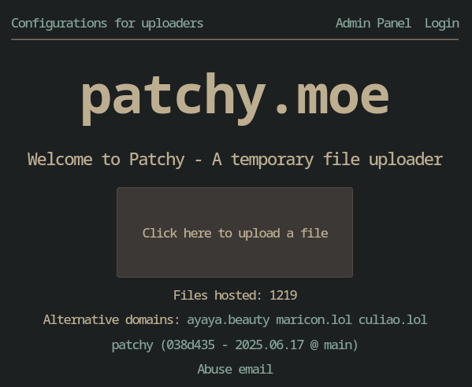

# Patchy

<!--
[](https://translate.codeberg.org/engage/patchy)
[](https://translate.codeberg.org/engage/patchy)
-->

[English 🇬🇧](./README.md)

---

Простой в размещении временный загрузчик файлов, созданный для замены
[Uguu](https://github.com/nokonoko/uguu), который сложно развернуть из-за PHP.

Использует мало памяти, работает без JS, совместим с Chatterino2 и ShareX, а
также имеет другие функции, перечисленные ниже.

Основной сервер: [patchy.moe](https://patchy.moe)

## Почему Patchy?

Сначала я хотел назвать его Patchouli в честь
[Patchouli Knowledge](https://en.touhouwiki.net/wiki/Patchouli_Knowledge), но
уже были проекты с таким именем (вероятно, по той же причине - им нравится
Touhou). Поэтому я выбрал **Patchy** - так Remi называет Patchouli.

Почему Patchy и как это связано с загрузчиком файлов? Подумайте: Patchy - это
библиотекарь, книги - это файлы, а Patchy - это ПО, которое ими управляет ;)


> <https://safebooru.org/index.php?page=post&s=view&id=905633>

## Скриншоты

### С включенным JavaScript



### С отключенным JavaScript


## Возможности

- Временная загрузка файлов, как в Uguu
- Ссылка для удаления файла (пока недоступна в версии без JS)
- Поддержка Chatterino и ShareX
- Миниатюры для OpenGraph User-Agents (требуется `ffmpeg`, по умолчанию
  отключено)
- Ограничение скорости загрузки (на основе IP-адреса)
- [Небольшой Admin API](./src/routes/admin/) для удаления файлов, получения
  информации о них, просмотра кэша в ОЗУ и другого (нужно включить в конфиге)
- Поддержка Unix-сокетов, чтобы избежать накладных расходов TCP
- Автоопределение протокола (HTTPS или HTTP)
- Кэширование файлов в памяти для снижения нагрузки на диск через
  [LRU](https://en.wikipedia.org/wiki/Cache_replacement_policies#LRU) (подробнее
  в [config.example.yml](./config/config.example.yml))
- Низкое потребление памяти: от 6 МБ в простое до 40 МБ при загрузке или чтении
  файла. Зависит от трафика, включения кэша и вычисления контрольных сумм.
- **Экспериментальная** поддержка S3 bucket (миниатюры OpenGraph недоступны,
  протестировано с [Minio](https://min.io))
- Поддержка локализации (сейчас поддерживаются английский, испанский и русский)
- Блокировка VPN (не самое необходимое, но полезное дополнение) (**В
  разработке**)

## Планы

<https://codeberg.org/Fijxu/patchy/issues/9>.

## Документация

[./docs](./docs/)

## Зеркала репозитория

Исходный код Patchy размещен здесь:

- <https://git.nadeko.net/Fijxu/patchy>
- <https://codeberg.org/Fijxu/patchy>
- <https://app.radicle.xyz/nodes/iris.radicle.xyz/rad:z2n2ykznv2cwJZNTfbQUcvUECxPBq>

## Как разместить Patchy

### Контейнеры

Patchy публикует образы в два реестра: `git.nadeko.net` (конечно тут) и
`quay.io`. Вы можете использовать любой удобный реестр.

- `git.nadeko.net/fijxu/patchy:latest`
- `quay.io/fijxu/patchy:latest`

#### Docker Compose / Podman Compose

- Создайте папку с любым именем
- Скачайте файл [docker-compose.yml](./docker-compose.yml) в созданную папку
- **Если вы используете Docker**, создайте папку данных: `mkdir ./data && sudo
  chown -R 10000:10000 ./data`
- Запустите через `docker compose up` (Docker) или `podman compose up` (Podman).
  Если всё работает, добавьте флаг `-d` для запуска в фоне.

#### Kubernetes

> [!NOTE]
>
> TODO.

### Нативная установка (самостоятельная компиляция)

- Создайте пользователя для загрузчика: `sudo useradd -u 10000 patchy` (имя
  можно изменить)
- Клонируйте репозиторий, например, в `/opt/patchy`
- Установите Crystal и скомпилируйте загрузчик: `shards build --release`
- Настройте файл `./config/config.yml` под свои нужды.
- Настройте службу systemd для автозапуска. Скопируйте
  [patchy.service](./patchy.service) в `/etc/systemd/system/patchy.service`
- Выдайте права на папку `/opt/patchy` пользователю `patchy`: `sudo chown -R
  10000:10000 /opt/patchy`
- Запустите загрузчик: `sudo systemctl start patchy`

> [!WARNING]
>
> Это не тестировалось. Если возникнут проблемы, создайте issue!

## Блок сервера NGINX

Если вы уже используете NGINX, вы можете использовать этот пример блока сервера.

```nginx
server {
  # Вы можете оставить домен с префиксом `~.`, если хотите
  # разрешить пользователям использовать любой домен для загрузки и получения
  # файлов. Например, xdxd.example.com или lolol.example.com
  # Это будет работать только при наличии wildcard-домена и сертификата.
  server_name ~.example.com example.com;

  location / {
    proxy_pass http://127.0.0.1:8080;
    # Если вы хотите использовать UNIX-сокет вместо этого:
    # proxy_pass http://unix:/tmp/patchy.sock;
    proxy_set_header X-Real-IP   $proxy_add_x_forwarded_for;
    proxy_set_header X-Forwarded-Proto $scheme;
    proxy_set_header X-Forwarded-Host  $host;
    proxy_pass_request_headers      on;
  }

  # Это значение должно соответствовать size_limit (из config.yml)
  client_max_body_size 512M;

  listen 443 ssl;
  http2 on;
}
```

<!--
## Переводы

Не стесняйтесь переводить Patchy на свой язык, если он здесь не поддерживается:
<https://translate.codeberg.org/projects/patchy/patchy> (требуется аккаунт Codeberg)

[](https://translate.codeberg.org/engage/patchy)
-->

## Разработка

Patchy использует Nix как основную среду разработки для установки зависимостей,
таких как `forgejo-runner` для тестирования Actions, `pre-commit` для хуков и
других инструментов из [flake.nix](./flake.nix)

### Подготовка среды для разработки

> [!NOTE]
>
> TODO.
